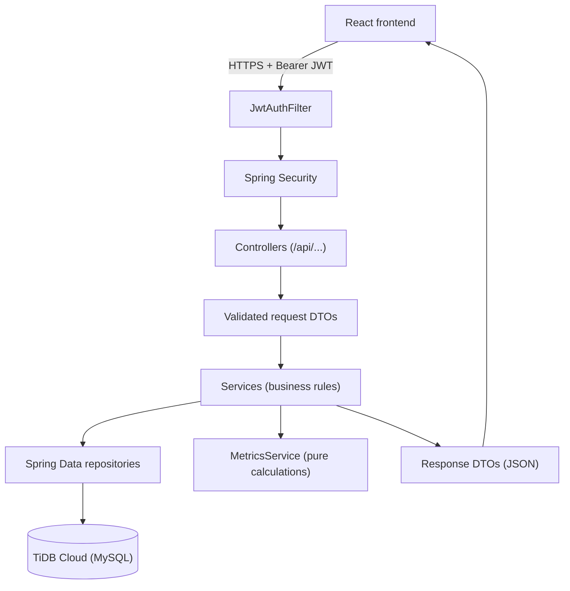
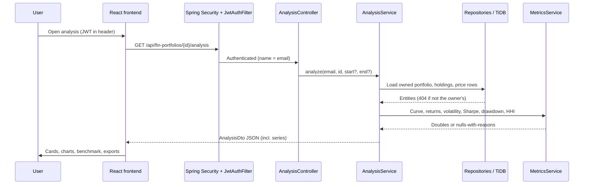
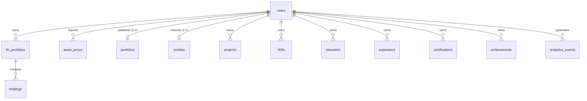

<div align="center">

# PortfolioPilot — Backend

**Quantitative portfolio risk, return, and diversification analysis — API service.**


**[Live application](https://portfolio-pilot-frontend-pi.vercel.app)** ·
[API base](https://portfolio-pilot-api-0e01.onrender.com) ·
[Frontend repo](https://github.com/shb09/portfolio-pilot-frontend) ·
[Monorepo](https://github.com/shb09/portfolio-pilot)

*Explore it live: the frontend above exercises every endpoint below end to end.*

</div>

This service receives the frontend's HTTP requests, validates and authorizes every
operation, applies portfolio and financial logic, persists to TiDB Cloud, and returns
structured JSON. It executes no trades and makes no market predictions — it measures
portfolios from imported historical prices.

## Contents

- [Links](#links)
- [Features](#features)
- [Architecture](#architecture)
- [Request lifecycle](#request-lifecycle)
- [API reference](#api-reference)
- [Database design and schema](#database-design-and-schema)
- [Financial logic and formulas](#financial-logic-and-formulas)
- [CSV import and validation](#csv-import-and-validation)
- [Authentication and security](#authentication-and-security)
- [Directory structure](#directory-structure)
- [Setup and local execution](#setup-and-local-execution)
- [Environment-variable reference](#environment-variable-reference)
- [Testing and quality](#testing-and-quality)
- [Deployment and operations](#deployment-and-operations)
- [Limitations and future improvements](#limitations-and-future-improvements)
- [Related repositories](#related-repositories)

## Links

| | |
|---|---|
| **Live frontend** | [https://portfolio-pilot-frontend-pi.vercel.app](https://portfolio-pilot-frontend-pi.vercel.app) |
| **Backend API base** | [https://portfolio-pilot-api-0e01.onrender.com](https://portfolio-pilot-api-0e01.onrender.com) |
| **Backend repository (this repo)** | [https://github.com/shb09/portfolio-pilot-backend](https://github.com/shb09/portfolio-pilot-backend) |
| **Frontend repository** | [https://github.com/shb09/portfolio-pilot-frontend](https://github.com/shb09/portfolio-pilot-frontend) |
| **Monorepo (full history)** | [https://github.com/shb09/portfolio-pilot](https://github.com/shb09/portfolio-pilot) |

Stack: Java 21 · Spring Boot 3.2.5 · Spring Web / Data JPA / Security / Validation /
Mail / OAuth2-client · Hibernate · JJWT · BCrypt · Maven · TiDB Cloud (MySQL-compatible,
sole database; Hikari pool, max 5).

## Features

- **REST API** — controllers under `/api/...` plus one public path (`/portfolio/:username`);
  health probes at `GET /api/health` and `GET /api/health/db`.
- **Authentication** — immediate-login registration (account is ACTIVE on creation, JWT
  returned), username-or-email password login, email verify/resend, forgot/reset, and
  Google OIDC authorization-code flow with one-time handoff codes.
- **Authorization** — every financial and career record resolves through the JWT owner's
  id; cross-user access returns 404, anonymous access 401.
- **Portfolios & holdings** — full CRUD for `FinPortfolio` and nested holdings (symbol
  unique per portfolio, positive finite quantities).
- **CSV price import** — validated `date,symbol,close` ingestion with per-row errors and
  duplicate skipping (unique per user/symbol/date).
- **Financial engine** — valuation, allocation/HHI, simple returns, cumulative and
  annualized return, sample volatility, Sharpe (rf = 0), max drawdown, aligned-window
  benchmark comparison (active return, tracking error), and a plottable value series;
  optional `?start=&end=` windows. Nulls always carry reasons — never NaN/Infinity.
- **Persistence & validation** — Spring Data JPA repositories, Bean Validation on every
  request DTO, `ddl-auto=update` schema management (no migration tool).
- **Error handling** — `ResponseStatusException` mapped to `{ error, details }` JSON;
  wrong-method/unknown endpoints return 405/404, never 500.
- **Admin** — user stats and user listing for `ADMIN` role only.
- **Legacy career domain** (mounted but unlinked from the financial UI): profile,
  projects, skills, education, experience, certifications, achievements, readiness,
  publish/preview, analytics events.

## Architecture

- **Entry point:** `PortfolioPilotApplication` (Spring Boot).
- **Controllers** (`controller/`) — thin HTTP adapters, one per area (see API reference).
- **Services** (`service/`) — business rules (`FinPortfolioService`, `PriceService`,
  `AnalysisService`, `MetricsService` pure-math engine, `VerificationService`,
  `AuthService`, `MailService`, plus legacy career services).
- **DTOs** (`dto/`) — validated request records and response records; nothing else
  crosses the API boundary.
- **Entities** (`entity/`) / **repositories** (`repository/`) — JPA + Spring Data.
- **Security** (`security/` + `config/SecurityConfig.java`) — `JwtAuthFilter` populates
  authentication (name = email); BCrypt hashing; Google OIDC client registration built
  only from `GOOGLE_OAUTH_CLIENT_ID/SECRET`; in-memory rate limiter on abuse-prone
  endpoints; CORS origins from `app.cors.allowed-origins`.
- **Config** (`config/`) — CORS, security, OAuth client, admin bootstrap/reset runner,
  startup provisioning.



Typical analysis request:



Calculations themselves are pure functions of already-loaded rows — the database is
queried for inputs, never for precomputed results.

## Request lifecycle

1. Frontend sends HTTPS with `Authorization: Bearer <JWT>` (public paths omit it).
2. `JwtAuthFilter` validates the token (subject = email, `role` claim) or rejects 401.
3. Controller binds and Bean-validates the DTO (400 with field messages on failure).
4. Service enforces ownership (`findByIdAndUserId`, else 404) and business rules
   (409 on duplicate username/email/symbol, rate limits on resend/forgot).
5. Repositories read/write TiDB through JPA.
6. `MetricsService` computes results; uncomputable metrics become `null` + reason.
7. Response DTO serialized as JSON; frontend renders it.

## API reference

Base: `/api` (health under `/api`, one public route under `/portfolio`).
Auth: Bearer JWT except where noted. Conventions: 400 validation, 401 anonymous,
404 foreign/missing, 409 duplicate, 429 rate-limited.

### Authentication (`/api/auth`)

| Method + path | Purpose / body / notes |
|---|---|
| `POST /api/auth/register` | Create ACTIVE account, return JWT immediately. Body: `username` (3–30, lowercase letters/digits/`._-`), `name` (≤100), `email`, `password` (10–100 chars). 409 on taken username/email. Welcome mail best-effort only. |
| `POST /api/auth/login` | Body: `identifier` (username **or** email), `password`. Returns `{ token, user }`. |
| `GET /api/auth/verify?token=…` | Single-use expiring email verification link. |
| `POST /api/auth/resend` | Resend verification. Rate-limited: 3/hour per email. |
| `POST /api/auth/forgot` | Start password reset. Rate-limited: 3/hour per email. |
| `POST /api/auth/reset` | Complete reset with token + new password. |
| `GET /api/auth/oauth/status` | `{ "googleEnabled": true/false }` — true only when `GOOGLE_OAUTH_CLIENT_ID` is set. The login page shows the Google button from this. |
| `POST /api/auth/oauth/exchange` | Body: `{ code }` one-time handoff code (5-min TTL, single-use) → `{ token, user }`. |
| `GET /api/auth/me` | Current user (authenticated). |

Example:

```bash
curl -X POST $API/api/auth/register -H 'Content-Type: application/json' \
  -d '{"username":"asha-01","name":"Asha","email":"asha@example.com","password":"correct-horse-10"}'
# → {"token":"<JWT>","user":{"id":…,"username":"asha-01","role":"USER",…}}
```

### Portfolios & holdings (`/api/fin-portfolios`, authenticated)

| Method + path | Purpose |
|---|---|
| `GET /api/fin-portfolios` | List own portfolios (`id, name, description, benchmarkSymbol, holdingCount`). |
| `POST /api/fin-portfolios` | Create. Body: `name` (required, ≤100), `description`, `benchmarkSymbol` (optional, 1–20 uppercase letters/digits/dot/hyphen). → 201. |
| `GET /api/fin-portfolios/{id}` | One portfolio or 404. |
| `PUT /api/fin-portfolios/{id}` | Update (same contract). |
| `DELETE /api/fin-portfolios/{id}` | Delete → 204. |
| `GET /api/fin-portfolios/{id}/holdings` | Holdings (`symbol, assetCategory, quantity`). |
| `POST /api/fin-portfolios/{id}/holdings` | Add. Body: `symbol` (1–20 chars), `assetCategory` (≤50), `quantity` (positive finite). 409 if symbol already held. → 201. |
| `PUT /api/fin-portfolios/{pid}/holdings/{hid}` | Update holding. |
| `DELETE /api/fin-portfolios/{pid}/holdings/{hid}` | Delete → 204. |

### Prices (`/api/prices`, authenticated)

| Method + path | Purpose |
|---|---|
| `POST /api/prices/import` | Multipart field `file` (filename must end `.csv`). Returns `{ totalRows, imported, skippedDuplicates, errors[] }` with per-row `{ row, message }`. Max 20,000 rows. |
| `GET /api/prices/symbols` | Owned symbols. |
| `GET /api/prices?symbol=X&limit=60` | Recent closes `{ symbol, date, close }` (limit clamped 1–500). |

### Analysis (`/api/fin-portfolios/{id}/analysis`, authenticated)

`GET` with optional `?start=YYYY-MM-DD&end=YYYY-MM-DD` (400 on bad/inverted dates).
Returns `AnalysisDto`: `valuation { asOf, totalValue, positions[] { symbol,
assetCategory, quantity, lastPrice, lastDate, value, weight }, missingPrices }`,
`returns { observations, startDate, endDate, cumulativeReturn, annualizedReturn,
annualizedVolatility, sharpeRatio, maxDrawdown, reason }`,
`allocation { weights, hhi, hhiBand }`,
`benchmark { symbol, alignedObservations, benchmarkCumulativeReturn,
benchmarkAnnualizedReturn, activeReturn, trackingError, reason }`,
`warnings[]`, and `series[] { date, value, benchmarkValue }` for charting.

### Health, admin, legacy

- `GET /api/health` → `{ status: OK, service: portfolio-pilot }` (public).
  `GET /api/health/db` → TiDB reachability or 503.
- `GET /api/admin/stats`, `GET /api/admin/users` — `ADMIN` role only.
- Legacy career endpoints (mounted, unlinked from financial UI): CRUD under
  `/api/{projects,skills,education,experience,certifications,achievements}`,
  `/api/profile`, `/api/portfolio` (+ `/preview`), `/api/dashboard/*`,
  `/api/analytics/*`, public `GET /portfolio/{username}`.

## Database design and schema

- **Technology:** TiDB Cloud (hosted, MySQL-compatible) via MySQL Connector/J and
  Hibernate (`MySQLDialect`); sole database. Schema managed by
  `spring.jpa.hibernate.ddl-auto=update` — **no migration tool**; tables are created
  and evolved by Hibernate.
- **Conventions:** surrogate `IDENTITY` ids, `user_id` indexes on owned tables,
  `NOT NULL` foreign keys, lowercase-normalized unique usernames/emails.



| Table | Key columns / constraints |
|---|---|
| `users` | `id`, `name`, unique `username` (≤50), unique `email` (≤180), `password_hash` (BCrypt, never returned), `role` (default USER), `email_verified`, `enabled`, `verification_token_hash/expiry`, `reset_token_hash/expiry` |
| `fin_portfolios` | `id`, `user_id` → users (index), `name` (≤100), `description`, `benchmarkSymbol` (≤20) |
| `holdings` | `id`, `portfolio_id` → fin_portfolios, `symbol` (≤20), `assetCategory` (≤50), `quantity`; **unique(portfolio_id, symbol)** |
| `asset_prices` | `id`, `user_id` → users (index), `symbol` (≤20), `price_date`, `close`; **unique(user_id, symbol, price_date)** — the basis of duplicate-safe re-imports |
| `portfolios` / `profiles` | one row per user (`user_id` unique); username (≤50, unique), tagline, published flag |
| `projects`, `skills`, `education`, `experience`, `certifications`, `achievements` | `user_id` → users (indexed); career content fields |
| `analytics_events` | `owner_user_id` → users; event type + optional project ref |

Production credentials travel exclusively through environment configuration
(`TIDB_URL/USER/PASSWORD`); nothing secret is documented with real values here.

## Financial logic and formulas

All formulas verified in `service/MetricsService.java` and `service/AnalysisService.java`.
`TRADING_DAYS = 252`; fewer than 30 return observations is flagged indicative
(`ROBUST_OBSERVATIONS = 30`).

- **Valuation** — per holding: `quantity × latest close` (last observation carried
  forward per date); `totalValue` = sum; `weight = value / total`. Holdings without
  prices contribute 0 and are listed in `missingPrices`. Point-in-time (unaffected by
  `?start/&end`).
- **Weights** — value shares at latest prices, renormalized to sum to 1 inside HHI.
- **Periodic returns** — simple returns per observation: `close[i]/close[i-1] − 1`
  (daily for daily data, monthly for monthly data). Non-positive/non-finite closes skipped.
- **Cumulative return** — `last / first − 1` over the valued curve; null when < 2 prices.
- **Annualized return** — `(1 + cumulative)^(252 / n) − 1`, `n` = return observations;
  null when `n < 1` or base ≤ 0. On short/monthly windows this compounds into very large
  figures — mathematically consistent with the definition, flagged indicative, never a forecast.
- **Volatility** — **sample** standard deviation (ddof = 1) of simple returns × √252;
  null when < 2 returns or non-finite.
- **Sharpe ratio** — `mean(returns) × 252 / annualizedVolatility` with **risk-free rate
  fixed at 0**; null when volatility is missing or zero (flat series has no Sharpe).
- **Maximum drawdown** — largest peak-to-trough decline of the value curve normalized
  to its first value (`level/peak − 1`, ≤ 0); null when < 2 prices. Historical only.
- **HHI** — Σ (normalized weight)² on a 0–1 scale; bands: < 0.15 diversified,
  < 0.25 moderately concentrated, else highly concentrated (descriptive, not advice).
- **Benchmark comparison** — restricted to dates shared by both series: each side's
  cumulative + annualized return over the identical window; **active return** =
  portfolio cumulative − benchmark cumulative; **tracking error** = annualized std of
  paired daily return differences. Needs ≥ 2 shared dates.
- **Missing data** — every uncomputable metric returns `null` with a `reason`/warning;
  NaN and Infinity are never emitted.

## CSV import and validation

`PriceService.importCsv` reads UTF-8 text (see code references above for exact messages):

- Header row auto-detected on line 1 (`date,symbol,close`); blank lines skipped.
- Exactly 3 columns; `date` ISO `YYYY-MM-DD`, never in the future; `symbol`
  uppercased, 1–20 chars (letters/digits/dot/hyphen); `close` a positive finite number.
- Duplicate rows **within the file** are reported as errors; rows already stored
  (unique user/symbol/date) increment `skippedDuplicates` — re-imports never double-count.
- Cap: 20,000 rows per file; violations reported, import continues.
- Prices attach to the importing user; holdings resolve them by symbol at analysis time
  (last observation carried forward per date). Imported data feeds valuation, returns,
  and benchmark alignment.

## Authentication and security

- **Password auth:** registration normalizes username/email to lowercase, enforces the
  `RegisterRequest` contract, hashes with BCrypt (`BCryptPasswordEncoder`), creates an
  ACTIVE user, and returns a JWT — no verification gate. Wrong credentials → 401;
  unknown/duplicate identities → 404/409 with safe messages (no password oracle details).
- **JWT:** subject = email, `role` claim, 24 h expiry (`app.jwt.expiration-ms`,
  default 86,400,000 ms), HMAC key from `app.jwt.secret` (HS512 at ≥ 64 bytes, else
  HS256; startup fails fast on weak config). `JwtAuthFilter` authenticates each request.
- **Authorization ≠ authentication:** proving identity (JWT) is separate from record
  ownership — every data query scopes by owner id (`findByIdAndUserId`), so another
  user's id yields 404, never their rows.
- **Google OIDC:** `OAuthClientConfig` builds the client registration solely from
  `GOOGLE_OAUTH_CLIENT_ID/SECRET` env (absent = password-only, button hidden);
  authorization-code flow with redirect `…/login/oauth2/code/google`; frontend receives
  only a random 5-minute single-use handoff code (`HandoffStore`, TTL 300 s) exchanged
  at `/api/auth/oauth/exchange`. Secrets never touch the client or Git.
- **Abuse controls:** in-memory fixed-window `RateLimiter` — resend and forgot-password
  capped at 3/hour per email.
- **CORS:** `app.cors.allowed-origins` (default `http://localhost:5173`; production adds
  the Vercel URL). Dev proxy strips `Origin` so any localhost port works.
- **Mail:** welcome/verify/reset mails via Spring Mail; unconfigured host fails fast and
  registration proceeds (welcome is best-effort, failures only warn in logs).
- **Admin:** `APP_ADMIN_*` bootstrap plus password-reset runner; `/api/admin/*`
  requires `ADMIN`. No security module here claims complete protection — it documents
  what is enforced and where.

## Directory structure

```text
├── pom.xml                          # Spring Boot 3.2.5, Java 21, JJWT, MySQL, mail, oauth2-client
├── Dockerfile                       # multi-stage: maven:3.9-temurin-21 build → temurin 21-jre run
├── render.yaml                      # Render blueprint (free plan, /api/health check, env prompts)
├── docs/                            # PRD, API design, flows, architecture, DB design,
│                                    # deployment, security, increments
└── src/
    ├── main/java/com/portfoliopilot/
    │   ├── PortfolioPilotApplication.java
    │   ├── controller/              # 17 controllers (see API reference)
    │   ├── service/                 # business rules + MetricsService math engine
    │   ├── dto/                    # request/response records
    │   ├── entity/ / repository/    # JPA entities + Spring Data access
    │   ├── security/                # JwtService, JwtAuthFilter, OAuthHandlers,
    │   │                            # RateLimiter, TokenUtil
    │   └── config/                  # Security, CORS, OAuth client, admin runners
    ├── main/resources/application.properties   # PORT, TiDB, JWT, mail, OAuth, CORS, admin
    └── test/java/.../service/       # 10 test classes (Mockito unit tests)
```

## Setup and local execution

Prerequisites: JDK 21, Maven 3.9+, and either TiDB Cloud credentials or a local
MySQL-compatible database. Do **not** assume access to the production database.

```bash
git clone https://github.com/shb09/portfolio-pilot-backend.git
cd portfolio-pilot-backend
export JAVA_HOME=/Library/Java/JavaVirtualMachines/jdk-21.jdk/Contents/Home  # macOS example
export TIDB_URL='jdbc:mysql://<host>:4000/<db>?sslMode=VERIFY_IDENTITY&serverTimezone=UTC'
export TIDB_USER='<user>'
export TIDB_PASSWORD='<password>'
export JWT_SECRET='<≥64 random chars: openssl rand -hex 48>'
APP_AUTH_DEV_MODE=true mvn spring-boot:run   # :8080
mvn test                                       # full suite (10 classes)
mvn -B -DskipTests clean package               # jar → target/portfolio-pilot-*.jar
```

Troubleshooting: wrong Java → `mvn -v` must show 21; DB unreachable → check
`TIDB_URL/USER/PASSWORD` and TiDB IP allowlist; `:8080` busy → stop the other process;
OAuth invisible locally → set `GOOGLE_OAUTH_CLIENT_ID/SECRET`; mail errors → leave
`SPRING_MAIL_HOST` empty to run mail-less.

## Environment-variable reference

All server-only (never exposed to the browser).

| Variable | Purpose | Required | Example |
|---|---|---|---|
| `PORT` | HTTP port (Render injects) | No (default 8080) | `10000` |
| `TIDB_URL` | JDBC URL, TiDB/MySQL | Yes | `jdbc:mysql://<host>:4000/<db>?sslMode=VERIFY_IDENTITY&serverTimezone=UTC` |
| `TIDB_USER` / `TIDB_PASSWORD` | DB credentials | Yes | set in hosting dashboard |
| `JWT_SECRET` | HMAC key (≥64 chars for HS512) | Yes | `openssl rand -hex 48` output |
| `APP_BASE_URL` | Public URL used in email links (never localhost in prod) | Prod yes | `https://portfolio-pilot-frontend-pi.vercel.app` |
| `APP_CORS_ALLOWED_ORIGINS` | Comma-separated frontend origins (`app.cors.allowed-origins`) | Prod yes | `https://portfolio-pilot-frontend-pi.vercel.app` |
| `GOOGLE_OAUTH_CLIENT_ID` / `GOOGLE_OAUTH_CLIENT_SECRET` | Google OIDC (absent = password-only) | No | Google Cloud Console values |
| `SPRING_MAIL_HOST/PORT/USERNAME/PASSWORD` | SMTP (empty host = mail disabled) | No | provider SMTP settings |
| `APP_MAIL_FROM` | Sender header | No | `Portfolio Pilot <no-reply@example.com>` |
| `APP_ADMIN_EMAIL/USERNAME/PASSWORD` | Admin bootstrap | First deploy | dashboard-only values |
| `APP_AUTH_DEV_MODE` | Local-dev conveniences | No | `true` locally, never in prod |

Variables backed only by the hosting dashboard are marked as such where applicable;
nothing here carries a real value.

## Testing and quality

- Framework: JUnit 5 + Mockito (strict stubs), run with `mvn test` (JDK 21).
- Coverage: auth service, verification/resend/forgot/reset flows, ownership isolation
  (cross-user 404), metrics math, CSV import validation, Google linking, handoff codes,
  mail behavior, readiness, DTO validation, and date-windowed analysis with series —
  53 tests, all passing at last verification.
- No linter is configured for the backend; `mvn -B -DskipTests clean package` is the
  build gate (same command the Dockerfile runs).

## Deployment and operations

- Hosting: **Render** (Docker, free plan) from this repository's `main`; image builds
  via the multi-stage `Dockerfile` (Maven + Temurin 21 → slim JRE 21, `java -jar app.jar`).
- Health: `GET /api/health` (public, used as the Render health check) and
  `GET /api/health/db` (reports TiDB reachability or 503).
- Runtime needs: `JAVA 21` toolchain, `PORT` provided by Render, all required env above,
  TiDB reachable from Render's network.
- Operations: logs via Render dashboard; cold starts apply on the free plan (first
  request after ~15 min idle can take up to ~a minute — the frontend warns after 12 s).
- Links: API base [https://portfolio-pilot-api-0e01.onrender.com](https://portfolio-pilot-api-0e01.onrender.com),
  frontend [https://portfolio-pilot-frontend-pi.vercel.app](https://portfolio-pilot-frontend-pi.vercel.app).

## Limitations and future improvements

- Historical analysis only: no trading, no broker orders, no return forecasts.
- Metrics depend entirely on imported CSV quality; demo prices are simulated.
- Schema evolves via Hibernate `ddl-auto=update` (no versioned migrations).
- Free-tier hosting sleeps when idle; rate limits are in-memory (single instance).
- Ideas (not implemented): versioned migrations, refresh-token rotation, more benchmark
  presets, async mail with retries, broader backend integration tests.

## Related repositories

- Frontend client: [shb09/portfolio-pilot-frontend](https://github.com/shb09/portfolio-pilot-frontend)
- Monorepo with complete history: [shb09/portfolio-pilot](https://github.com/shb09/portfolio-pilot)
- Live app: [https://portfolio-pilot-frontend-pi.vercel.app](https://portfolio-pilot-frontend-pi.vercel.app)
